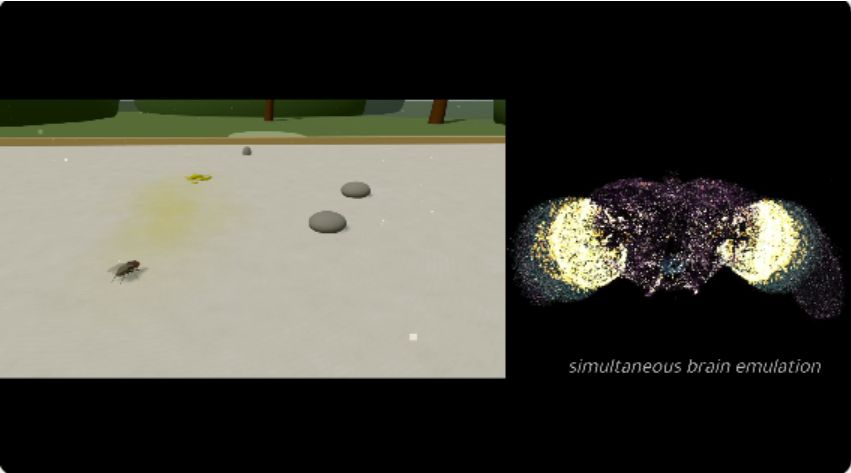
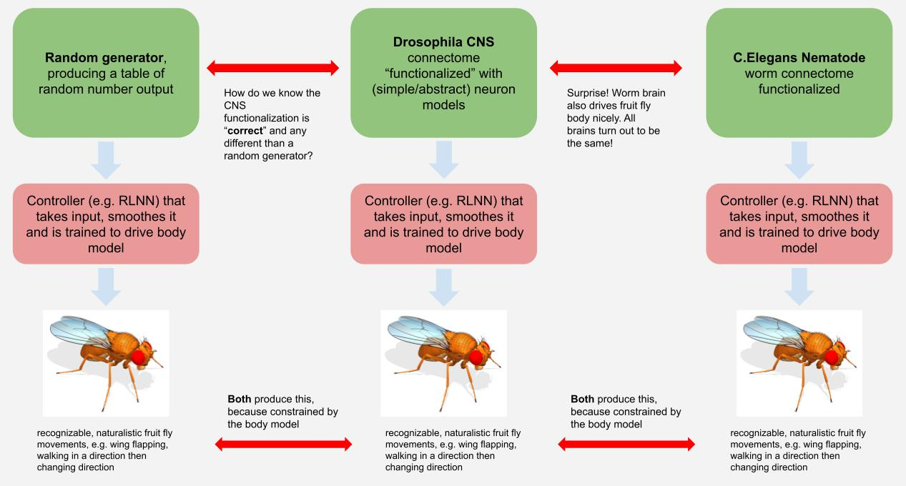
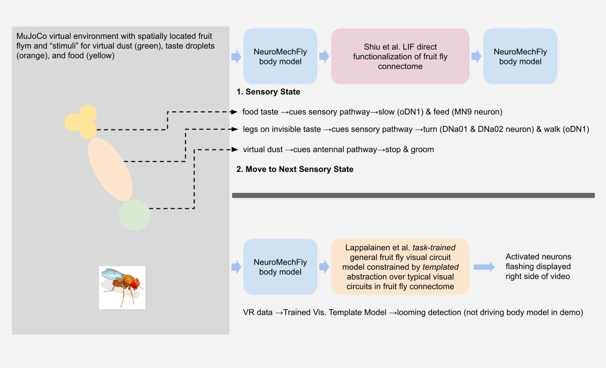

## The risk of "*Science by Press Release*" in the brain emulation community

Recent misunderstandings about viral Substack and X posts describing a demo by Eon Systems as a "fruit fly upload" reveal a risky communication pivot in the nascent field of [Whole Brain Emulation](https://carboncopies.org/Blog/Posts/WhatIsWholeBrainEmulation/Post/) (WBE). Some pop-sci media channels have been unable to parse the significance of the demo, drawing flawed conclusions from its visuals. Because of this, viral social media posts containing astonishing claims – intentionally or unintentionally – bypass the rigor that makes science "real." It’s time to set standards, requiring careful definitions and a scientific conversation about the success criteria and validation metrics to apply for specific brain emulation goals.

For context, in early March 2026, a couple of days after cofounder Alex Wissner-Gross [posted a demo video](https://x.com/alexwg/status/2030217301929132323) (excerpt in image above) created by Eon Systems, CEO Michael Andregg [seemingly confirmed on X](https://x.com/michaelandregg/status/2030764512488677736) that the company had succeeded in uploading a fruit fly.

This immediately resulted in millions of views and took the neuroscience community by surprise. Understandably, there was a mix of online euphoria and skepticism, with many questions. Eon Systems followed up with a technical detailing on the company website: [How the Eon Team Produced A Virtual Embodied Fly](https://eon.systems/updates/embodied-brain-emulation)

Let’s talk about the significance of the demo, its communication, and what it means to evaluate a brain emulation.

#### **Brain Emulation**

At the Carboncopies Foundation, we apply the following definition when we use the term emulation:

<table><tbody><tr><td>

An <em>emulation</em> is an artificial system built to reproduce all relevant behaviors of another system, by recreating the internal dynamics at some level of detail. In the context of whole brain emulation, the relevant behaviors are the cognitive processes resulting from the activity of the system.

Usage:
<ul>
	<li>A Commodore 64 emulation program recreates the behavior of the classic hardware faithfully enough to run unmodified Commodore 64 software, by recreating the instruction set and timing characteristics of the original hardware.</li>
	<li>The emulation of a hippocampal CA3 to CA1 circuit reproduces activities performed by a biological hippocampus by utilizing some of the internal mechanisms.</li>
</ul>

</td></tr></tbody></table>

The definition leaves a lot of room for interpretation, for two reasons:

1. Every emulation is built with a particular goal in mind. That goal determines where you apply a separation between functions that need to be replicated faithfully and the platform or substrate that can be exchanged beneath those functions. Brain emulation that is intended for “mind uploading” has a specific goal, and the corresponding success criteria include aspects that may not be fully interpretable from external behavior.

2. At this time, there is much that is not yet known about exactly how or [how much](https://journals.plos.org/plosone/article?id=10.1371/journal.pone.0326920) cognitive processes depend on accurately modeling detailed physiological processes in the biology of a brain.

#### **How Black Box I/O and Body Models can Hide Limitations of Emulation**

By embedding a questionable brain model into a highly constrained, pre-programmed body-model, the Eon Systems demo doesn’t just "give the brain a home" – it also creates a mask, a cloak of added constraints that can hide a model's failures.

In a simulated physics environment like MuJoCo, if you use a body model that is already programmed to balance, walk, and groom, the body itself does a lot of the "thinking." The body-model then acts as a low-pass filter that smooths out potentially chaotic or incorrect signals transpiring within the brain emulation.

The use of a pre-programmed body-model and a "closed-loop" virtual environment doesn't prove the emulation's success; rather, it obscures details of its potential invalidity. When the physical constraints of the body are rigid enough, almost any input can be made to look like "behavior."

For example, see in the diagram below how output from a random generator, a fruit fly model or even the model of a different animal’s brain can be made to look like fruit fly behavior.

In the Eon Systems demonstration, the body model contains the "intelligence" of locomotion. If the connectome sends a noisy, poorly timed signal, the body-model’s internal stabilizers and pre-set gait cycles take that "noise" and turn it into a "step."

* **The Result:** The viewer sees a fly walking.

* **The Reality:** The viewer is seeing the body-model’s code correcting the brain-model’s errors.

* **The Scientific Problem:** By using this framework, it is not possible to see if the connectome is actually producing the fine-tuned motor commands required for life. This replaces biological complexity with robotic "auto-correction."

There is probably room for some replacements of this kind when the goal is brain emulation for uploading. Perhaps steering a body that way is fine, but we don’t only care about external body control. We also care about internal thoughts, memory, emotional valence, and in mammals and certainly humans, conscious perception and experience.

By placing the fly in a simple environment with a sequence of singular tasks (start grooming when virtual dust accumulates, start following an odor gradient when detected, start feeding when food is detected), Eon Systems may have created a railroaded simulation (see diagram below).

* The environment may be so simple that there is only one correct action to take at each time step in the sequence.

* It may be impossible to tell if the brain model is actually making a decision or if the system is simply being pulled along by the hard-coded sensory-to-motor through-lines.

In the diagrammatic description of the demo above, also note that there are two separate brain models in play. The [Shiu et al (2024)](https://www.nature.com/articles/s41586-024-07763-9) model provides input-output pathways that turn on and off directives for the body model shown on the left side of the demo video. Activities in the separate Lappalainen et al model provide the illuminated neural activity shown on the right side of the demo video. Where the [Lappalainen et al (2024)](https://www.nature.com/articles/s41586-024-07939-3) model is concerned, it’s particularly important to realize that the model does not describe the workings of a specific fruit fly brain. It is a task-trained implementation of an artificial fruit fly visual system that was created by using a circuit template based on sampling many instances of the corresponding circuit in the fruit fly connectome.

Putting the Shiu et al brain model into a closed-loop behavior setup that treats the brain model as a black box is not enough to evaluate the degree of emulation. Validation requires looking at microcircuits, not just outputs. Specifically, thorough validation requires probing the internal dynamics of the 125,000 neurons to see if they replicate known biological patterns (e.g., the rhythmic oscillations of central pattern generators).

### **Separating Technical Reality from Visual Illusion**

Eon Systems certainly achieved a clever integration of preceding work, though the demonstration falls short of being a "functional upload".

* **Foundations:** They utilized the [FlyWire](https://www.science.org/doi/10.1126/science.add9330) connectome (Princeton/Janelia) and the [NeuroMechFly](https://www.nature.com/articles/s41592-022-01466-7) [v2 framework](https://www.nature.com/articles/s41592-024-02497-y) (EPFL).

* **A Puppet Effect:** The visually impressive behaviors such as walking, grooming, navigation are hard-coded routines within the body model. The connectome is not "generating" the walk; it is being used as a switch to trigger those pre-programmed scripts.

* **Simplified Dynamics:** Using Leaky-Integrate-and-Fire (LIF) models on a static map ignores metabolic, chemical, and temporal complexities that may be essential to an actual "mind." It is hard to tell to what degree that matters, because the focus of the demo is like a [*Braitenberg vehicle*](https://en.wikipedia.org/wiki/Braitenberg_vehicle): a toy that moves toward a signal, wrapped in the visual prestige of a neural map.

Eon Systems is right to point out in their [subsequent technical detailing](https://eon.systems/updates/embodied-brain-emulation) that there are valid reasons to explore the degree to which input-output (I/O) behavior produced by a brain can be captured purely by its connectivity structure and the relative strengths of pathways within that. The current demo is a minimal test thereof, and unfortunately the visual appeal produced by the puppet effect – at least in public perception – obscures the scientific conclusions that may be drawn.

### **Emulation is Not an "Auto-Pilot"**

The methodology presented by Eon Systems, testing a model based on its ability to complete a specified sequence of tasks in a simplified environment, is experimentally interesting, but is not how you validate a brain emulation. The approach treats the brain as a "Black Box" with minimal I/O, and it gives the impression that we score success based on whether the fly "reaches the food" rather than *how* it decided to get there.

<table><tbody><tr><td>

	Validating an emulation is not a test of "how well" a system performs a task; it is a test of correspondence.

	<ul>
		<li><b>The AI Approach</b>: If a reinforcement learning agent navigates a maze efficiently, it is a success. The internal logic doesn't have to look like a brain.</li>
		<li><b>The WBE Approach</b>: A successful emulation must replicate the internal dynamic states and microcircuit activities of the biological ground truth. You gain a higher "emulation score" not by finishing the task faster or better, but by ensuring the 100,000+ neurons in the model fire in the same patterns, sequences, and rhythms as they would in a living fly.</li>
	</ul>

</td></tr></tbody></table>

The problem of success criteria for brain emulation is a fundamental and important one. Any emulation, whether of a brain, a computer chip, global weather, or other natural systems, is created with a particular goal or application in mind. When the goal of brain emulation is for medical purposes, as in the case of personal “uploading”, the correspondence of internal states and dynamic processes can be even more important than observed behavioral task performance.

The published demo treats the brain as a black box. It prioritizes Task Performance (like an autopilot) over Biological Correspondence. If we don't inspect the "gears" of the clock, we can't claim we've built a clock that keeps track of time – we may instead have built a digital display that shows the right time because we are feeding it a list of times.

If we don't inspect the internal microcircuits, we cannot distinguish between a genuine emulation and a "lookup table" or a simple heuristic script.

### **Communicating Intent vs Evidence**

Social media is an excellent tool for sharing intentions, opportunities, and recruitment. It is a problematic tool for evaluating scientific results.

* **The Scientific Process:** Hypothesize, test, peer-review, and replicate. This process is slow because it is designed to filter out human ego and financial incentive.

* **The PR Process:** Hook, hype, and go viral. This process is fast because it prioritizes views by reporters and investors over expert scrutiny.

Bypassing peer review avoids the essential "stress test" that distinguishes a breakthrough from marketing.

There is a serious risk that click-driven reporting will follow the initial viral posts, drowning out and nearly incapacitating any self-correction by expert follow-up, as was demonstrated in this case by *Futurism’s* [entirely uncritical reporting](https://futurism.com/science-energy/research-fly-brain-matrix) that completely misunderstands what is real and what is illusion. They report, “*In a video shared by Eon Systems cofounder Alex Weissner-Gross, the crudely animated insect can be seen stretching its legs inside a simulated sandbox, rubbing its front feet together and using its labellum to drink from a small bowl.*”

In reality, the detailed behavior that impressed *Futurism* is a product of a pre-programmed body model and not caused by simulation based on the fruit fly’s connectome. In other words, they report the illusion of the slick demo, not the scientific reality.

### **Real Risks of Scientific Sensationalism**

History is littered with the evidence of damage to scientific fields that traded rigor for a PR splash. We have seen this cycle before, and how it can result in a "winter" of funding and trust:

* [**The "Bull" Control**](https://www.inhn.org/fileadmin/previews/Case_Study_Delgado.pdf)**:** Jose Delgado’s 1960s sensationalism regarding radio-controlled mind control set neuromodulation back decades.

* **Cold Fusion (1989):** [A press conference announcement](https://undsci.berkeley.edu/cold-fusion-a-case-study-for-scientific-behavior/publication-by-press-conference/) that promised limitless energy and delivered only a lasting stigma on the field of nuclear physics.

* **The "Sentient Pong" Debacle:** Recent overreach regarding in-vitro neurons has already begun to tire the public and the scientific community with "sentience" claims that don't hold water.

Brain emulation has only recently moved from the "scoffed-at science fiction" bin to serious laboratory research. We cannot afford to destroy decades of hard-won credibility for a single company's investment round. **Trust takes decades to build but only one disappointment to shatter.**

### **Success in Brain Emulation**

The recent surge in public interest has provided a unique opportunity to mature the field. We are now seeing a necessary shift toward defining the exact engineering benchmarks and validation steps required to substantiate such a breakthrough

The goal of Brain Emulation is not to build a system that *acts* like a fly; it is to build a system that *is* the fly’s functional architecture. True validation requires us to open the hood, inspect the microcircuits, and prove that the internal dynamics match the biological ground truth – both when the fly is performing a task and, more importantly, when it isn't.

There isn’t yet consensus on a full list of success criteria, but they almost certainly have to include internal dynamic states.

* Does the digital fly have the same internal compass dynamics as a biological one?  
* Does it exhibit the same state-dependent transitions?  
* Does the "upload" carry the specific memories or synaptic weights of an individual?

If the answer is no, it is a generic model, not an upload. Claiming otherwise is a semantic bait-and-switch that misleads the public.

We must demand that scientific rigor be the norm. If a lab or company claims to have achieved the "first multi-behavior brain upload," that claim belongs not in a Substack post, but in the pages of *Nature* or *Science* with open-source code and auditable data.

#### **Post-script**

At the Carboncopies Foundation, we are advocating for a rigorous approach to the theory and validation of brain emulation, particularly now that modeling is becoming possible based on the wealth of collected data. We ran a workshop in 2025 that included the authors of the well-known Nature papers (Philip Shiu, as well as Jeanne Lappalainen) focused on precisely this problem. Our main research project at this time is the development of a Brain Emulation Challenge with the same focus. We invite Eon Systems and everyone else in this fledgling community to come together to ensure scientific progress and its evaluation is done in a way that maximally advances the field.
