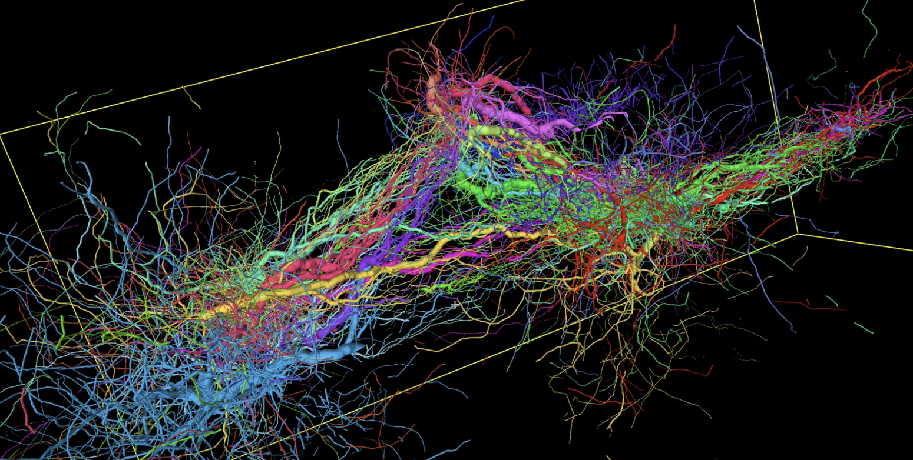

# BrainGenix: Accelerating WBE Research and Clinical Neuroscience

BrainGenix is an open-source project focused on advancing **whole brain emulation (WBE)** research and clinical neuroscience. Its core mission is to provide a **modular, reproducible stack** that researchers can use on their own hardware. All code is open-source and freely available under the **AGPL-3.0 license**, promoting fairness and accessibility.

---

## Key Components & GitLab Locations

The BrainGenix platform consists of several key components, each with a specific purpose. All repositories are public, licensed under AGPL-3.0, and include documentation, and example workflows.

| Component | Purpose | GitLab Repo |
| :--- | :--- | :--- |
| NES – Neuronal Emulation System | Executes biologically-realistic neuronal simulations | `https://gitlab.braingenix.org/carboncopies/BrainGenix-nes` |
| API – BrainGenix API Server | Unified REST/JSON interface for all services | `https://gitlab.braingenix.org/carboncopies/BrainGenix-API` |
| ERS – Environment Rendering System | Generates virtual environments and sensory translation for emulations | `https://gitlab.braingenix.org/carboncopies/BrainGenix-ERS` |
| EVM – Evaluation Metrics | Quantifies accuracy of participant emulations in the Brain Emulation Challenge | `https://gitlab.braingenix.org/carboncopies/BrainGenix-EVM` |
| STS – Scan Translation System | Converts EM, electrophysiology, and other scan data into NES-compatible models | `https://gitlab.braingenix.org/carboncopies/BrainGenix-STS` |
| VSDA – Virtual Scan Data Acquisition | Simulates data acquisition pipelines for testing and training | `https://gitlab.braingenix.org/carboncopies/BrainGenix-VSDA` |

---

## Guide Overview

-   **:material-rocket-launch: Getting Started**

    ---

    Step-by-step setup from zero to a running BrainGenix installation. Covers hardware and software requirements, backend installation, and Python client setup. Start here if you're new to the platform.

    [:octicons-arrow-right-24: Getting Started](/Research/BrainGenix/GettingStarted/Overview)

-   **:material-brain: Virtual Brain Platform**

    ---

    The `pyBrainGenixClient` Python library — the primary interface for building and running experiments. Covers simulation creation, geometry and neuron models, virtual data acquisition tools (electrodes, EM renderer, calcium imaging), and 3D visualization.

    [:octicons-arrow-right-24: Virtual Brain Platform](/Research/BrainGenix/Divisions/PythonClient/Overview)

-   **:material-trophy: Brain Emulation Challenge**

    ---

    Documentation for the WBE Challenge competition framework. Includes challenge level descriptions (L1–L2), submission format, meaningful operations criteria, and how to submit a solution for scoring.

    [:octicons-arrow-right-24: Brain Emulation Challenge](/Research/BrainGenix/Challenge/Overview)

-   **:material-server: Backend Divisions**

    ---

    Reference documentation for the three backend services that power the platform: **NES** (neuronal simulation engine), **EVM** (evaluation and scoring metrics), and **API** (the unified REST gateway between client and services).

    [:octicons-arrow-right-24: NES](/Research/BrainGenix/Divisions/NES/Overview) &nbsp; [:octicons-arrow-right-24: EVM](/Research/BrainGenix/Divisions/EVM/Overview) &nbsp; [:octicons-arrow-right-24: API](/Research/BrainGenix/Divisions/API/Overview)

-   **:material-source-pull: Contribute**

    ---

    How to contribute code, documentation, or datasets to BrainGenix. All repositories are open-source under AGPL-3.0 and welcome community participation.

    [:octicons-arrow-right-24: Contribute](/Research/BrainGenix/Contribute/Contribute)

